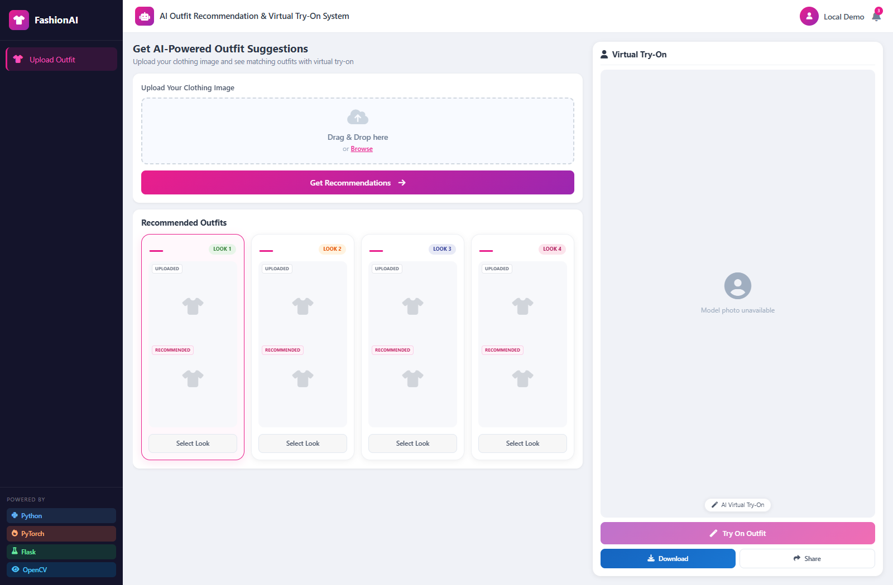
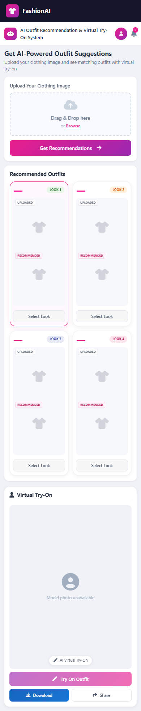

# AI Recommended Outfit & VTON System

**FashionAI: outfit recommendations with CLIP, plus a two-pass OOTDiffusion virtual try-on.**

A local research application that accepts a clothing image, recommends four
complementary catalog garments, and generates an outfit on a supplied model
photograph. Flask serves the interface; separate Python environments keep the
CPU recommendation stack and CUDA diffusion stack compatible.



*Privacy-safe capture of the real application before adding a model photograph
and restoring the catalog. No customer photo or restricted dataset image is
included in this repository.*

## What Works

- Clothing upload with image-content validation and drag-and-drop support.
- CLIP ViT-B/32 embeddings, category pairing, quality heuristics, and four recommendations.
- Segmentation-based previews generated from locally downloaded masks.
- Selected-outfit generation: HD upper-body pass, then DC lower-body pass.
- Background progress, result display, and image download.
- Responsive desktop, tablet, and phone layouts.
- Resumable downloads with checksum verification and safe ZIP extraction.

**This is a research prototype, not a production fitting service.** Match
percentages are heuristic display values, not calibrated accuracy. Generated
garments can change shape, sleeve length, and detail. See [test results and
limitations](docs/TESTING.md) before interpreting a result.

## Start Here

The tested setup is **Windows x64**, Python **3.13** for `venv`, Python **3.10**
for `ootd_env`, and an NVIDIA CUDA-compatible GPU for diffusion. GPU inference
was exercised on a Quadro RTX 4000 with 8 GB VRAM. CPU-only recommendations work;
CPU-only try-on is not implemented.

1. Follow the [complete setup guide](SETUP_GUIDE.md) to create both environments.
2. Fetch the pinned source with `scripts/setup_ootdiffusion.py`.
3. Review the dataset agreement, download assets, then build the catalog locally.
4. Add a permitted model photo in `static/model/base_model.jpg`.
5. Start the app from the project directory:

```powershell
.\venv\Scripts\python.exe -m flask --app app run --host 127.0.0.1 --port 5055 --no-reload
```

Open **http://127.0.0.1:5055**. Upload a clean shirt or pants image, get
recommendations, select a look, and generate the outfit. Submit one generation
at a time. The first recommendation loads CLIP and may download its cached
weights. Inference can take several minutes or longer on the tested GPU.

No OpenAI API key, Kaggle account, or paid inference API is required. Internet
is needed for initial downloads and the Bootstrap/Font Awesome CDN styles.

## Downloads, Not Repository Files

| Asset | Source | Approximate download | Local destination |
| --- | --- | --- | --- |
| Processed DeepFashion-MultiModal data | [Text2Human data preparation](https://github.com/yumingj/Text2Human#1-dataset-preparation) | 6.06 GB archive | `Kaggle_datasets/` |
| OOTDiffusion models | [Official checkpoints](https://huggingface.co/levihsu/OOTDiffusion/tree/main/checkpoints) | Included in 17.04 GB total | `OOTDiffusion/checkpoints/` |
| CLIP image encoder | [CLIP ViT-L/14](https://huggingface.co/openai/clip-vit-large-patch14) | Included in model total | `OOTDiffusion/checkpoints/clip-vit-large-patch14/` |
| Recommendation encoder | [OpenAI CLIP](https://github.com/openai/CLIP) | About 354 MB | Local CLIP cache |

The dataset has a [non-commercial research agreement restricting
redistribution](https://github.com/yumingj/DeepFashion-MultiModal#agreement).
Images, masks, annotations, and prebuilt derived catalog files are not shipped.
Each installation downloads data from the original provider and builds
`catalog_metadata.json` and `catalog_vectors.npy` locally.

## How It Fits Together

```text
Clothing image
    -> validation and upload
    -> garment-category detection + CLIP embedding
    -> complementary-category search + quality ranking
    -> four local catalog previews
    -> selected shirt and pants
    -> OOTDiffusion HD: shirt onto the model photograph
    -> OOTDiffusion DC: pants onto the first-pass result
    -> new PNG result
```

| File or Folder | Responsibility |
| --- | --- |
| `app.py` | Flask routes, uploads, crops, generation, progress, job admission |
| `recommender.py` | Lazy CLIP loading, category detection, pairing, ranking, deduplication |
| `build_index.py` | Builds normalized 512-dimensional embeddings and metadata locally |
| `garment_cleaner.py` | Try-on suitability scoring and optional cleaning helpers |
| `templates/index.html` | Layout and controls |
| `static/js/main.js` | Uploads, recommendations, selected look, polling, downloads |
| `static/css/style.css` | Styling and responsive layout |
| `scripts/` | Source bootstrap, downloads, checks, screenshots, publication audit |
| `patches/ootdiffusion-local.patch` | Documented adaptation of pinned upstream source |
| `OOTDiffusion/` | Downloaded upstream dependency; ignored by the parent repository |
| `docs/` | Architecture, testing, publication, and licensing notes |

The [architecture guide](docs/ARCHITECTURE.md) explains each script, runtime
folder, endpoint, environment, and inference handoff.

## Phone Layout



## Verification

Lightweight offline checks need no weights, dataset, or GPU:

```powershell
py -3.10 -m venv .test_env
.\.test_env\Scripts\python.exe -m pip install -r requirements-test.txt
.\.test_env\Scripts\python.exe scripts/test_restore_assets.py
.\.test_env\Scripts\python.exe scripts/test_job_guard.py
```

Full verification needs restored assets, a locally built index, model photo,
and two clothing samples. See [testing commands](docs/TESTING.md).
The GitHub workflow checks source and offline safety, not CUDA inference.

## Documentation

- [Setup and troubleshooting](SETUP_GUIDE.md)
- [Architecture and file responsibilities](docs/ARCHITECTURE.md)
- [Verified behavior and limitations](docs/TESTING.md)
- [Exact publication policy](docs/PUBLISHING.md)
- [Third-party sources and terms](THIRD_PARTY.md)
- [Security boundaries](SECURITY.md)
- [MIT license for original code](LICENSE)
- [License scope and exclusions](LICENSE_POLICY.md)

## Credits and Scope

This project integrates [CLIP](https://github.com/openai/CLIP),
[OOTDiffusion](https://github.com/levihsu/OOTDiffusion), and processed data from
[Text2Human](https://github.com/yumingj/Text2Human). It does not claim to have
trained those pretrained models. Upstream source, weights, datasets, and
personal photographs retain their own terms. Publication of original project
source does not grant permission to redistribute those assets.
